# Arquitectura del Sistema, Modelo de Datos y Reglas Matemáticas (Edición 2026)
**Proyecto:** Desafío Argon High — Sistema de Inteligencia Comercial Multifuente
**Ecosistema:** Distribuidora de Bebidas | Cervecería y Maltería Quilmes (CMQ) | Programa Galaxia 2026

---

## 1. Arquitectura Modular de la Solución

La aplicación fue diseñada bajo una arquitectura modular desacoplada que funciona **100% localmente en el navegador** (sin requerir servidores externos, bases de datos remotas ni conexión a internet) y es compatible tanto con ejecución mediante servidor local (`server.js` / `iniciar_servidor.bat`) como mediante apertura directa (`file://`). Todos los módulos en `src/modules/` implementan un patrón UMD dual (`window.ArgonBI` en navegador y `module.exports` en Node.js), permitiendo que la suite de pruebas automatizadas verifique exactamente el mismo código que ejecuta la interfaz gráfica.

```mermaid
flowchart TD
    subgraph UI["Capa de Interfaz Corporativa (index.html + corporate.css + app.js)"]
        V1["Dashboard Ejecutivo (KPIs, Gráficos, Tablas)"]
        V2["Tablero de Ventas (TACO .xlsb)"]
        V3["Programa Galaxia 2026 (Scorecard 11k pts)"]
        V4["Consultas en Lenguaje Natural (NLQ)"]
        V5["Hallazgos Comerciales Automáticos"]
        V6["Importación Multifuente (1 a 10 archivos)"]
        V7["Mapa de Relaciones e Integridad"]
        V8["Logística, Activos Fijos y Trade MKT"]
        V9["Auditoría del Ecosistema (20 Fuentes)"]
        V10["Centro de Exportaciones (CSV, XLSX, PDF, PPTX)"]
    end

    subgraph CORE["Núcleo de Ingeniería de Datos y BI (src/modules/)"]
        M0["galaxiaEngine.js (11.000 pts, Escala CMQ, TACO Slicers)"]
        M1["sanitizer.js (Prevención XSS y Normalización)"]
        M2["ingestionEngine.js (Lectura Excel/XLSB/CSV, Detección de Hojas)"]
        M3["relationshipEngine.js (Claves Candidatas, Huérfanos, 20 Fuentes)"]
        M4["customConsolidator.js (Deduplicación y Conversión HL = Litros / 100)"]
        M5["commercialMathEngine.js (Motor Matemático Verificable)"]
        M6["insightEngine.js (Detección de Desviaciones y Oportunidades)"]
        M7["nlqEngine.js (Intérprete Semántico Local con Focos 2026)"]
        M8["persistenceEngine.js (IndexedDB + Rollback Snapshot)"]
        M9["exportEngine.js (Generación CSV, XLSX, PDF y PPTX Editable)"]
    end

    subgraph DATA["Fuentes de Datos y Persistencia Local"]
        D1["20 Fuentes Reales en 1. Bases/ (real_data_bundle.js - 21 MB)"]
        D2["10 Archivos Sintéticos Controlados (synthetic_test_bundle.js)"]
        D3["IndexedDB (ArgonHighBI_DB_v1)"]
    end

    UI --> CORE
    CORE --> DATA
```

---

## 2. Reglas de Consolidación y Anti-Duplicación

1. **Reconciliación entre `(Actualizar) Base Prod. y Vol..xlsx` y `(Actualizar) Base a la fecha.xlsx`:**
   - Clave primaria compuesta transaccional: `Año/Mes | Código Cliente | Código Producto | Código Sector de Venta`.
   - Ambas bases comparten exactamente `266,041` registros de bebidas con `0.00 HL` y `$0,00` de diferencia (`96,607.03 HL` y `$14.823.747.363,87` Importe Neto).
   - `(Actualizar) Base a la fecha.xlsx` contiene `55` registros adicionales correspondientes a `División = POP` (`SKU 29056`, `0.00 HL`, `262 Bultos`, `$1.018.594,84` Importe Neto).
   - El motor consolida ambas bases mediante diccionario hash de clave compuesta, obteniendo exactamente `266,096` registros únicos sin duplicar ningún registro de venta.
2. **Deduplicación de `(Actualizar) Base CNC.xlsx`:**
   - De las `25,895` filas brutas, se detectaron `2` claves `(Año/Mes, Cod Cte)` duplicadas en `2026/09` (`1,388` filas para `1,386` clientes únicos). El motor conserva `25,893` claves únicas priorizando `Comprador = SI` si existiese conflicto.
3. **Preservación de Claves Huérfanas:**
   - Los productos `78043` (`248.62 HL`, `$49.946.463,29`, `División = CCU`) y `29056` (`0.00 HL`, `$1.018.594,84`, `División = POP`) no existen en `(Fijo) Base Portfolio.xlsx`. En lugar de descartar sus ventas o inventar marcas ficticias, se asignan a la categoría explícita `SIN MAESTRO (SKU 78043 / 29056)` utilizando la columna `División` de la propia base de ventas.
4. **Ingesta Binaria BIFF12 de `Tablero Ventas.xlsb` (17.5 MB):**
   - El motor utiliza SheetJS con un parche a nivel de parser binario para el registro de celda `0x3b` (`BIFF12_CELL_BLANK`), permitiendo decodificar las 55 hojas binarias del tablero original sin cuelgues ni corrupción de memoria.

---

## 3. Especificación del Motor Matemático Comercial (`commercialMathEngine.js`)

| Indicador | Fórmula Matemática Implementada | Regla de Protección / Validación |
|---|---|---|
| **Conversión a Hectolitros (`HL`)** | $\text{HL} = \frac{\text{Litros}}{100}$ cuando la columna de origen está en Litros (ej. `Litros Repago` en `Activos Fijos` o `Litros_Vendidos` en lotes personalizados). Si ya está en `Hectolitros`, se preserva sin volver a dividir. | Evita subestimar o sobreestimar por un factor de 100. |
| **Variación Absoluta (`Var Abs`)** | $\Delta_{\text{abs}} = V_{\text{actual}} - V_{\text{anterior}}$ | Calculada sobre períodos homogéneos. |
| **Variación Porcentual (`Var %`)** | $\Delta_{\%} = \left(\frac{V_{\text{actual}} - V_{\text{anterior}}}{V_{\text{anterior}}}\right) \times 100$ | Si $V_{\text{anterior}} = 0 \land V_{\text{actual}} > 0 \implies \text{"Sin base comparable"}$ (`pct = null`). Si $V_{\text{anterior}} = 0 \land V_{\text{actual}} = 0 \implies 0.00\%$. Si $V_{\text{anterior}} < 0 \implies \text{"Base negativa no comparable"}$. |
| **Comparación `YTD` Homogénea** | Detecta los meses activos del año actual (`2026/01` a `2026/09`) y filtra exactamente los mismos meses del año anterior (`2025/01` a `2025/09`). | Nunca compara 9 meses de 2026 contra 12 meses de 2025 como si fuera `YTD`, salvo que el usuario seleccione explícitamente el modo `Año Completo`. |
| **Clientes Con Compra (`CCC`)** | $\text{CCC}(P) = \left|\{\text{Código Cliente} \mid \sum_{t \in P} \text{Bultos}_{c,t} > 0 \lor \sum_{t \in P} \text{HL}_{c,t} > 0 \lor \sum_{t \in P} \text{Neto}_{c,t} > 0\}\right|$ | Calcula la cardinalidad del conjunto (`Set`) de clientes únicos en el período seleccionado. **Jamás suma los CCC de cada mes** (`1,482` clientes únicos reales en YTD 2026 frente a `9,081` de suma mensual ingenua). |
| **Participación Interna (`Share %`)** | $\text{Participación}_{i} = \left(\frac{\text{Valor}_{i}}{\sum_{j \in \text{Selección}} \text{Valor}_{j}}\right) \times 100$ | Se etiqueta explícitamente como **Participación Interna** (nunca *Market Share* de mercado externo) y la suma de los segmentos dentro de una vista equivale al `100.00%`. |
| **Cumplimiento de Objetivo (`% Cumpl.`)** | $\text{Cumplimiento}_{\%} = \left(\frac{\text{Real}}{\text{Objetivo}}\right) \times 100$ | Si $\text{Objetivo} \le 0$, devuelve `"Sin objetivo asignado"`. |

---

## 4. Motor de Gobernanza Programa Galaxia 2026 (`galaxiaEngine.js`)

El Programa de Excelencia Galaxia 2026 de Cervecería y Maltería Quilmes (Manual Externo de Distribuidores, 212 páginas) se evalúa sobre una matriz oficial de **11.000 Puntos**:

$$\text{Puntaje Total} = \text{Gestión Manual (55\% = 6.050 pts)} + \text{Resultados TACO (40\% = 4.400 pts)} + \text{Bonus Galaxia (5\% = 550 pts)}$$

### 4.1. Escala Oficial de Alcance CMQ (6 Tramos)
A cada indicador se le aplica la escala discreta corporativa según su porcentaje de cumplimiento de meta:
- $\text{Alcance} < 70.00\% \implies \textbf{0\%}$ del puntaje máximo del ítem ($0 \text{ pts}$).
- $70.00\% \le \text{Alcance} \le 79.99\% \implies \textbf{50\%}$ del puntaje.
- $80.00\% \le \text{Alcance} \le 89.99\% \implies \textbf{60\%}$ del puntaje.
- $90.00\% \le \text{Alcance} \le 99.99\% \implies \textbf{80\%}$ del puntaje.
- $100.00\% \le \text{Alcance} \le 104.99\% \implies \textbf{100\%}$ del puntaje.
- $\text{Alcance} \ge 105.00\% \implies \textbf{110\%}$ del puntaje (Bonus por sobrecumplimiento).

### 4.2. Auditoría de los 8 Pilares del Negocio
1. **Pilar 1 (Estructura y On Premise 2026):** Mapeo de la fuerza de venta (25 colaboradores activos) y clasificación de los 209 clientes activos On Premise (`REG BAR`: 49, `REG RESTAURANTE`: 47, `GASTRONÓMICO`: 62, `ENTRETENIMIENTO`: 23, `EVENTOS`: 16, `NOCTURNO`: 8, `HOTEL`: 4).
2. **Pilar 2 (Frecuencias y Maestro Clientes):** Padrón auditado de 8.071 clientes (1.485 activos, 6.586 anulados). Integridad GPS: 92.05% de coordenadas válidas (brecha de 2.95% vs meta $\ge 95\%$). Auditoría presencial: **16 clientes con exceso de frecuencia (>2 visitas semanales)** detectados para readecuación de ruteo.
3. **Pilar 3 (Cobertura CNC Multi-Horizonte):** Tasa de compra sobre padrón activo a Últimos 3 Meses (1.337 PDVs = 90.0%), Últimos 6 Meses (1.393 PDVs = 93.8%) y Últimos 12 Meses (1.442 PDVs = 97.1%).
4. **Pilar 4 (Objetivación y Sensibilización 66/33):**
   $$\text{Peso Sugerido \%} = \frac{2}{3} \times (\% \text{ Share Real}) + \frac{1}{3} \times (\% \text{ Share Objetivo})$$
   Banda de tolerancia: $\pm 10.0\%$. En Volumen Total se identifican 2 promotores en alerta (`Vendedor 9 - Supermercados` con $+14.97\%$ y `Vendedor 10 - Vta Depósito` con $+25.76\%$).
5. **Pilar 5 (Ejecución de Mercado & Rutina Matinal SPV):** Cronograma de avance del Censo Thomas (52.95% al día 12 vs meta $\ge 50\%$) y matriz operativa de los 4 focos diarios (Volumen, Cobertura, Ejecución, Digital) por preventista.
6. **Pilar 6 (Ecosistema Digital BEES & Logística D+):** Facturación digital (98.48% de adopción BEES) y tasa de rechazos logísticos reducida al 0.44% (meta $<1\%$).
7. **Pilar 7 (CAPEX Coolers & Chopp):** Parque de 2.000 activos fijos. Stock en depósito Clúster 2: 22.81% (229 equipos en stock s/ 1.004 parque activo; alerta vs meta $\le 3\%$). Equipos en PDV sin venta: 2.97% (23 de 775 instalados).
8. **Pilar 8 (Revenue Management & Trade Spend):** Control de inversión comercial ($\$40.859/\text{HL}$ y $5.83\%$ de la facturación bruta). Ranking TOP 5 Clientes por canal con comparativa R3 (promedio últimos 3 meses) y MMAA (mismo mes año anterior).

---

## 5. Módulo Tablero de Ventas (TACO `.xlsb`) y Drill-Down Jerárquico

El módulo reproduce el entorno del libro `Tablero Ventas.xlsb`:
- **Mesas de Control:** Conmutación entre `Mando Integral` (Score KPI: 72.69%, RTO: 30.37%, Total: 46.77%), `Mesa Julio` (Score KPI: 67.13%) y `Mesa Gonza` (Score KPI: 69.33%).
- **Slicers Interactivos Cruzados:** Filtros dinámicos por Mesa, Supervisor, Promotor, Tipo Preventa (Primaria / Merchand / On Premise), Canal, Subcanal, Estado de Cliente (Activo / Anulado / Plan Cerveza) y Búsqueda textual.
- **Drill-down Jerárquico en 5 Niveles:**
  $$\text{Distribuidor} \longrightarrow \text{Supervisor} \longrightarrow \text{Promotor} \longrightarrow \text{Canal / Subcanal} \longrightarrow \text{Cliente Individual}$$
  Permite auditar el cumplimiento de cuota desde la cúpula directiva hasta el PDV específico con su ruteo y periodicidad.
