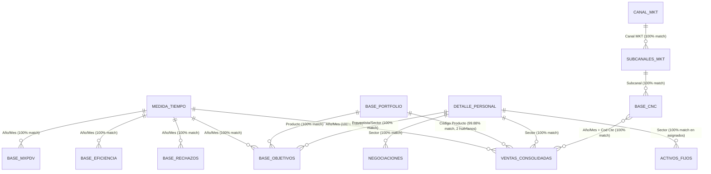

# Inventario Exhaustivo de las 14 Fuentes Reales y Análisis de Estructuras
**Proyecto:** Desafío Argon High — Sistema de Inteligencia Comercial Multifuente  
**Carpeta de origen:** `c:\Users\thoma\OneDrive\Desktop\Argon Gemini`

---

## 1. Resumen Global del Relevamiento

Antes de diseñar la arquitectura y el motor matemático del dashboard, se inspeccionaron programáticamente los **14 archivos comerciales reales** presentes en el workspace (`9` archivos clasificados como `(Actualizar)` y `5` archivos clasificados como `(Fijo)`).

- **Total de archivos inspeccionados:** `14` archivos `.xlsx` (ninguno modificado, renombrado ni eliminado).
- **Total de hojas detectadas:** `18` hojas (`13` archivos de hoja única + `1` archivo con `5` hojas en `(Actualizar) Negociaciones.xlsx`).
- **Total de filas brutas leídas:** `971,226` registros.
- **Períodos activos en bases transaccionales:** `21` meses (`2025/01` a `2026/09`).
- **Períodos definidos en calendario maestro `(Fijo) Medida Tiempo.xlsx`:** `24` meses (`2025/01` a `2026/12`), por lo que el `4Q 2026` (`2026/10` a `2026/12`) aún no registra ventas cargadas.

---

## 2. Tabla Maestra del Inventario de las 14 Fuentes

| # | Archivo | Clasificación | Formato | Hojas Disponibles | Rol Semántico | Filas Válidas | Columnas Relevantes | Claves Candidatas | Relaciones Detectadas | Advertencias Técnicas y Hallazgos | Uso en el Dashboard |
|---|---|---|---|---|---|---:|---|---|---|---|---|
| 1 | `(Actualizar) Activos Fijos.xlsx` | Actualizar | `.xlsx` | `Hoja1` (1) | Maestro / Estado de Equipos de Frío (Coolers) | `2,000` | `Chapa`, `Numero de Serie`, `Modelo`, `Estado`, `Codigo Cliente`, `Sector`, `Volumen promedio`, `Objetivo`, `Estatus`, `Litros Repago`, `Numero de Serie_2` | `Chapa` (PK 100% única), `Codigo Cliente` (FK), `Sector` (FK) | `Codigo Cliente` $\to$ Clientes (`775` asignados en PDV); `Sector` $\to$ `(Fijo) DetallePersonal.xlsx` | **1)** Carácter de control ASCII `\u0002` en encabezado col 22 (`\u0002Numero de Serie`). **2)** Nombre de columna `Numero de Serie` duplicado (cols 2 y 22). **3)** `Litros Repago` (`451,816 L`) está en **Litros** y se convierte a `4,518.16 HL` (`Litros / 100`). **4)** `1,225` equipos están en `EN STOCK` / `DE BAJA`. | Auditoría de parque de frío (2.000 coolers), análisis de productividad (`LENTO` / `SIN VENTA`) y recupero de inversión. |
| 2 | `(Actualizar) Base a la fecha.xlsx` | Actualizar | `.xlsx` | `Sheet1` (1) | Ventas Transaccionales Acumuladas (con POP) | `266,096` | `Año/Mes`, `Código Sector de Venta`, `Código Cliente`, `Nombre Cliente`, `Código Producto`, `Bultos`, `Hectolitros`, `Importe Bruto`, `Bonificación`, `Importe Neto`, `Impuestos Internos`, `División` | Compuesta: `(Año/Mes, Código Cliente, Código Producto, Código Sector de Venta)` (`100%` única) | `Código Producto` $\to$ `Base Portfolio`; `Código Sector de Venta` $\to$ `DetallePersonal`; `Código Cliente` $\to$ `Base CNC`; `Año/Mes` $\to$ `Medida Tiempo` | **Solapamiento 100% con `Base Prod. y Vol.`:** Contiene exactamente las mismas `266,041` filas de bebidas (`96,607.03 HL`, `$14.823.747.363,87`) más **55 filas adicionales** de `División = POP` (`0 HL`, `262 Bultos`, `$1.018.594,84` Neto). Sumar ambas tablas duplicaría el 100% de las ventas. | Fuente primaria de Facturación Neta, Bonificaciones, Impuestos, Bultos, HL y Clientes Con Compra (`CCC`). |
| 3 | `(Actualizar) Base CNC.xlsx` | Actualizar | `.xlsx` | `Sheet1` (1) | Padrón Mensual de Clientes y Condición de Compra | `25,893` *(de 25,895)* | `Año/Mes`, `Zona`, `Sector`, `Subcanal`, `Cod Cte`, `Razón Social`, `Domicilio`, `Localidad`, `Ramo`, `Frecuencia`, `Comprador` | Compuesta: `(Año/Mes, Cod Cte)` | `Cod Cte` $\to$ Ventas (`Código Cliente`); `Subcanal` $\to$ `(Fijo) Subcanales Mkt.xlsx`; `Sector` $\to$ `(Fijo) DetallePersonal.xlsx` | **Duplicados reales:** En `2026/09` existen `1,388` filas para `1,386` clientes únicos (`2` registros duplicados de `(Año/Mes, Cod Cte)`), que el motor deduplica automáticamente a `25,893` claves únicas. | Cobertura del padrón total (`1,588` clientes únicos), Clientes Sin Compra (`CNC = NO Comprador`), localidad y ramo. |
| 4 | `(Actualizar) Base Eficiencia.xlsx` | Actualizar | `.xlsx` | `Sheet1` (1) | Eficiencia de Entregas, Costo de Flete y Efectividad | `21` | `Año/Mes`, `Planificados`, `Reales`, `Recorridos`, `Efectividad Visita`, `Efectividad Entrega`, `Total Costo Flete`, `Costo $/Hl`, `Costo $/Bto` | `Año/Mes` (PK 100% única, 21 meses) | `Año/Mes` $\to$ `(Fijo) Medida Tiempo.xlsx` (`Año/Mes`) | Tabla agregada mensualmente (`2025/01` a `2026/09`). `Total Costo Flete` acumula `$1.883.854.790,51`. | Indicadores logísticos, efectividad de visita/entrega y costo logístico por HL (`$/HL`) y por bulto (`$/Bto`). |
| 5 | `(Actualizar) Base MXPDV.xlsx` | Actualizar | `.xlsx` | `Sheet1` (1) | Mix de Marcas por Punto de Venta (MXPDV) | `21` | `Año/Mes`, `Promedio de Marcas`, `Total Clientes`, `Objetivo Marcas` | `Año/Mes` (PK 100% única, 21 meses) | `Año/Mes` $\to$ `(Fijo) Medida Tiempo.xlsx` (`Año/Mes`) | Tabla agregada mensualmente (`2025/01` a `2026/09`). El promedio de marcas oscila alrededor de `6.1` frente a objetivos de `7.0–7.5`. | Seguimiento de amplitud de portafolio por PDV (`MXPDV Real vs Objetivo`). |
| 6 | `(Actualizar) Base Obj..xlsx` | Actualizar | `.xlsx` | `Sheet1` (1) | Objetivos / Presupuesto Comercial | `591,870` | `Año/Mes`, `Preventista`, `Cliente`, `Producto`, `Subcanal`, `Ramo`, `Hectolitros`, `Importe Neto`, `Unidad de Negocio`, `Marca`, `Categoría`, `Empaque`, `Calibre` | Compuesta: `(Año/Mes, Preventista, Cliente, Producto)` (`100%` única) | `Producto` $\to$ `Base Portfolio`; `Preventista` $\to$ `DetallePersonal`; `Subcanal` $\to$ `Subcanales Mkt`; `Año/Mes` $\to$ `Medida Tiempo` | Volumen total presupuestado en los 21 meses: `105,634.12 HL` y `$15.276.091.773,37` Neto (`37,168.41 HL` en YTD 2026). | Cálculo de cumplimiento de metas (`Real vs Objetivo`) por mes, unidad de negocio, marca y preventista. |
| 7 | `(Actualizar) Base Prod. y Vol..xlsx` | Actualizar | `.xlsx` | `Sheet1` (1) | Ventas Transaccionales de Bebidas (sin POP) | `266,041` | `Año/Mes`, `Código Sector de Venta`, `Código Cliente`, `Nombre Cliente`, `Código Producto`, `Bultos`, `Hectolitros`, `Importe Bruto`, `Bonificación`, `Importe Neto`, `Impuestos Internos`, `División` | Compuesta: `(Año/Mes, Código Cliente, Código Producto, Código Sector de Venta)` (`100%` única) | Idénticas a `(Actualizar) Base a la fecha.xlsx` | Sus `266,041` registros son **100% idénticos** en volumen (`96,607.03 HL`) e importe neto (`$14.823.747.363,87`) a los registros de bebidas de `Base a la fecha.xlsx`. | Reconciliada y deduplicada clave por clave con `Base a la fecha.xlsx` para garantizar cero duplicación de ventas. |
| 8 | `(Actualizar) Base Rechazos.xlsx` | Actualizar | `.xlsx` | `Sheet1` (1) | Rechazos y Devoluciones en Ruta | `21,760` | `Año/Mes`, `Sector`, `Cod Cte`, `Razón Social`, `Producto`, `Descripción`, `Bultos Rechazados`, `Hectolitros Rechazados`, `Importe Rechazado`, `Motivo de Rechazo`, `Frecuencia` | Compuesta: `(Año/Mes, Sector, Cod Cte, Producto, Motivo de Rechazo)` (`100%` única) | `Producto` $\to$ `Base Portfolio`; `Sector` $\to$ `DetallePersonal`; `Cod Cte` $\to$ `Base CNC`; `Año/Mes` $\to$ `Medida Tiempo` | Acumula `4,904.14 HL` rechazados (`42,578` bultos, `$781.908.600,66`) en 21 meses (`5.08%` sobre el volumen vendido). En YTD 2026 suma `1,722.41 HL` (`5.11%`). | Análisis de tasa de rechazo (`% HL Rechazado`), causales (`CERRADO`, `FALTA DE DINERO`, `SIN PEDIDO`) y supervisores. |
| 9 | `(Actualizar) Negociaciones.xlsx` | Actualizar | `.xlsx` | `5 hojas`: `Negociaciones`, ` Resumen por estado`, `Tipo de inversion`, `Clientes con acuerdo`, `Contratos por mes` | Acuerdos Comerciales e Inversiones de Trade MKT | `630` *(hoja 1)* + `35` *(resúmenes)* | Hoja 1: `Fecha Inicio`, `Fecha Fin`, `Cod Cliente`, `Nombre Cliente`, `Canal`, `Subcanal`, `Sector`, `Supervisor`, `Estado`, `Tipo Inversion`, `Inversion Total $`, `Volumen Comprometido HL`, `Volumen Real HL`, `% Cumplimiento` | `Cod Cliente` + `Fecha Inicio` + `Tipo Inversion` | `Cod Cliente` $\to$ Clientes (`197` PDV con acuerdo); `Sector` $\to$ `DetallePersonal`; `Subcanal` $\to$ `Subcanales Mkt` | **Estructura multi-hoja irregular:** **1)** En la hoja `Negociaciones`, la **fila 2 no es un dato**, sino descriptores de tipo (`["FECHA","FECHA","ENTERO","CARÁCTER",...]`); el motor la excluye dejando `630` acuerdos válidos. **2)** La hoja ` Resumen por estado` tiene un espacio inicial en el nombre. **3)** Las hojas 2 a 5 tienen un título en fila 1 y encabezados reales en fila 2. | Control de inversión de Trade MKT (`$235.025.635,51`), acuerdos vigentes (`207`), vencidos (`219`) y cumplimiento de HL comprometidos (`18,162.82 HL` reales vs `23,365.41 HL` comprometidos). |
| 10 | `(Fijo) Base Portfolio.xlsx` | Fijo | `.xlsx` | `Hoja1` (1) | Maestro de Productos y Portafolio (SKUs) | `1,673` | `Codigo Producto`, `Descripcion Producto`, `Unidad de Negocio`, `Marca`, `Categoria`, `Empaque`, `Calibre`, `Retornabilidad`, `Sabor`, `Factor HL` | `Codigo Producto` (PK 100% única, `1,673` SKUs) | Maestro referenciado por `Base a la fecha`, `Base Prod. y Vol.`, `Base Obj.` y `Base Rechazos` | Existen **2 códigos de producto huérfanos** en las bases de ventas que no figuran en este maestro: SKU `78043` (`División = CCU`, `248.62 HL`) y SKU `29056` (`División = POP`, `0 HL`, `$1.018.594,84`). El motor los preserva y documenta como `Sin Maestro (SKU 78043 / 29056)`. | Jerarquía maestra de producto: Unidad de Negocio (`CCU`, `DANONE`, `VMN`, `ADYACENCIAS`), Categoría, Marca, Empaque y Calibre. |
| 11 | `(Fijo) Canal MKT.xlsx` | Fijo | `.xlsx` | `Hoja1` (1) | Maestro de Canales de Marketing | `9` | `Canal MKT`, `Descripcion Canal` | `Canal MKT` (PK 100% única, 9 canales) | Referenciado por `(Fijo) Subcanales Mkt.xlsx` | Define los 9 canales estratégicos (`TRADICIONAL`, `AUTOSERVICIOS`, `SUPERMERCADOS`, `MAYORISTAS`, `ON PREMISE`, `KIOSCOS`, `E-COMMERCE`, `EVENTOS`, `OTROS`). | Agrupación comercial macro por Canal de Marketing. |
| 12 | `(Fijo) DetallePersonal.xlsx` | Fijo | `.xlsx` | `Hoja1` (1) | Maestro de Fuerza de Ventas (Rutas, Preventistas y Supervisores) | `29` | `Sector`, `Preventista`, `Supervisor`, `Zona`, `Canal Ruta` | `Sector` (PK 100% única, sectores `101` a `129`) | Referenciado por Ventas (`Código Sector de Venta`), `Base CNC`, `Base Obj.`, `Base Rechazos`, `Activos Fijos` y `Negociaciones` (`100%` match) | `29` rutas/sectores distribuidos en `4` Supervisores (`SUPERVISOR NORTE`, `SUPERVISOR SUR`, `SUPERVISOR ESTE`, `SUPERVISOR OESTE`). Coincidencia del `100%` en todas las tablas transaccionales. | Análisis de desempeño por Supervisor, Preventista, Zona y Sector de Venta. |
| 13 | `(Fijo) Medida Tiempo.xlsx` | Fijo | `.xlsx` | `Hoja1` (1) | Maestro de Calendario Comercial | `24` | `Año/Mes`, `Año`, `Mes`, `Nombre Mes`, `Trimestre`, `Semestre`, `Dias Habiles` | `Año/Mes` (PK 100% única, `2025/01` a `2026/12`) | Referenciado por todas las tablas con columna `Año/Mes` (`100%` match en los 21 meses activos) | Define los trimestres (`1Q`, `2Q`, `3Q`, `4Q`) y días hábiles para `2025` y `2026`. Permite detectar que `2026/10` a `2026/12` aún no tienen ventas cargadas. | Comparaciones homogéneas `YTD` (`Ene–Sep 2026` vs `Ene–Sep 2025`), agregación por Trimestre (`1Q–4Q`) y velocidad por día hábil. |
| 14 | `(Fijo) Subcanales Mkt.xlsx` | Fijo | `.xlsx` | `Hoja1` (1) | Maestro de Subcanales y Puente hacia Canal MKT | `33` | `Subcanal`, `Descripcion Subcanal`, `Canal MKT` | `Subcanal` (PK 100% única, 33 subcanales) | Referenciado por `Base CNC`, `Base Obj.` y `Negociaciones`; conecta con `(Fijo) Canal MKT.xlsx` (`100%` match) | Actúa como tabla puente entre el `Subcanal` del cliente (`Base CNC` / `Base Obj.`) y el `Canal MKT`. | Segmentación de clientes y volumen por Subcanal y Canal de Marketing. |

---

## 3. Mapa de Relaciones y Auditoría de Integridad Referencial

